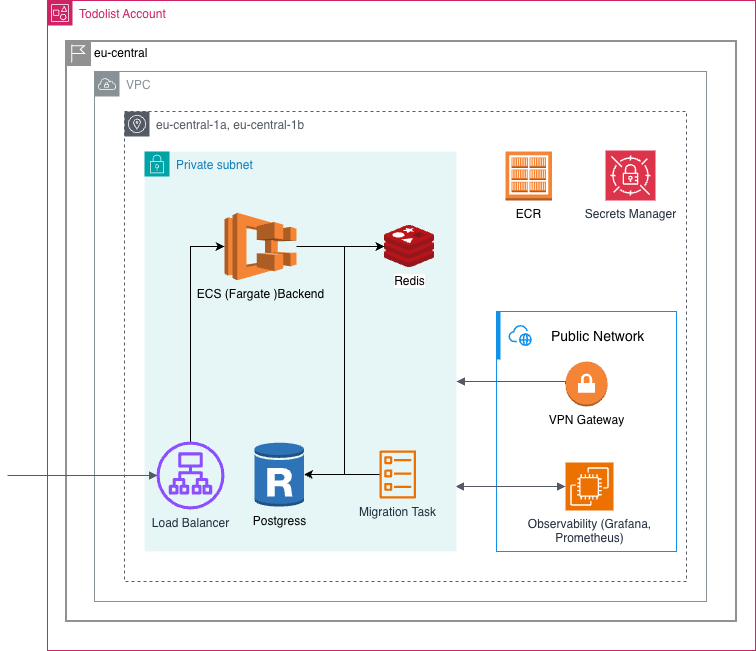

  

_AI made writing the code easy. Running it in production is still hard._

**Prod Forge** is an open-source reference that shows how to take a system to production: AI-assisted
development, quality gates, CI/CD, infrastructure, observability, migrations, and rollback.

The implementation is a simple Todo app on purpose, but the architecture follows patterns used in real production
systems, and every major technical decision is documented and explained.

## What you will find

- **Safe releases:** migrations run as a one-off ECS task before the deploy, a rollback switches to one of the last
  three task revisions, and in-flight requests drain on `SIGTERM`.
  [Release Management](https://github.com/prod-forge/backend/blob/main/guide/release-management.md)
- **One trace ID end to end:** created in the browser, carried to the backend logs, Sentry and Tempo.
  [Client Observability](https://github.com/prod-forge/frontend/blob/main/guide/client-observability.md#trace-id-end-to-end)
- **Web and mobile from one core:** a React client and an Expo app share one Redux store, API client and set of design
  tokens. [Mobile Client](https://github.com/prod-forge/frontend/blob/main/guide/mobile-client.md#what-is-shared-and-what-is-not)
- **A design system with gates:** every Storybook story has a visual snapshot and an axe-core accessibility check.
  [Design System](https://github.com/prod-forge/frontend/blob/main/guide/design-system.md)
- **Infrastructure you can review:** dev and prod from one Terraform module, GitHub OIDC instead of static keys, offline
  `checkov` and `tflint` on every pull request.
  [Environments](https://github.com/prod-forge/terraform/blob/main/guide/environments.md)
- **Numbers, not promises:** RPO about 5 minutes, a cost estimate of about 150 USD a month for dev and 580 USD for prod.
  [Backup and DR](https://github.com/prod-forge/terraform/blob/main/guide/backup-and-dr.md),
  [Cost](https://github.com/prod-forge/terraform/blob/main/guide/cost.md)
- **AI-assisted development with guardrails:** `AGENTS.md`, a `docs/` reference and approved plans in every repository,
  behind the same quality gates as hand-written code.
  [AI-Assisted Development](https://github.com/prod-forge/backend/blob/main/guide/ai-development.md)

## Start here

Read the guides in this order:

| Step | Guide                                                                  | Chapters | Time   | Question it answers                                            |
| ---- | ---------------------------------------------------------------------- | -------- | ------ | -------------------------------------------------------------- |
| 1    | [Backend guide](https://github.com/prod-forge/backend#readme)          | 16       | ~3 h   | How do I build and operate a production-ready API?             |
| 2    | [Frontend guide](https://github.com/prod-forge/frontend#readme)        | 17       | ~2 h   | How do I build, ship, and keep web and mobile clients healthy? |
| 3    | [Infrastructure guide](https://github.com/prod-forge/terraform#readme) | 15       | ~1.5 h | How do I run all of it on AWS with code, not clicks?           |

## Architecture and stack

  

| Layer          | Tools                                            |
| -------------- | ------------------------------------------------ |
| Web Client     | React · Vite · Redux Toolkit · Tailwind CSS · NX |
| Mobile Client  | Expo · React Native · Redux Toolkit              |
| Deploy         | AWS S3 · CloudFront · ECR · ECS                  |
| Backend        | NestJS · Prisma · PostgreSQL · Redis · Docker    |
| Infrastructure | Terraform · AWS · RDS · ElastiCache              |
| Observability  | Prometheus · Grafana · Loki · Promtail · Tempo   |
| Quality        | ESLint · Prettier · Husky · Commitlint · CI/CD   |

## What this is and what it is not

- A reference with explained decisions: chapters explain what was chosen and why.
- A Todo app on purpose: the domain stays trivial so the production practices stay visible.
- Not a boilerplate or a starter kit to fork and ship as is.
- Not a framework: take the patterns that fit your system and leave the rest.

## Intentionally out of scope

- Identity provider and password management: the API verifies signed JWTs and ships a login-by-email stub, see [Authentication and Authorization](https://github.com/prod-forge/backend/blob/main/guide/security.md#authentication-and-authorization)
- Cursor pagination: list endpoints use offset pagination, see [Performance](https://github.com/prod-forge/backend/blob/main/guide/performance.md#offset-vs-cursor-pagination)
- Live demo or public deployment
- Feature flags
- A/B testing

**Open roadmap:** Kubernetes, blue/green deployment and other open items are tracked in the roadmaps of
[backend](https://github.com/prod-forge/backend/blob/main/roadmap.md),
[frontend](https://github.com/prod-forge/frontend/blob/main/roadmap.md) and
[terraform](https://github.com/prod-forge/terraform/blob/main/roadmap.md).

## Status

| Repository                                           | Latest version                                                       | CI                                                                                                  | Docs chapters |
| ---------------------------------------------------- | -------------------------------------------------------------------- | --------------------------------------------------------------------------------------------------- | ------------- |
| [backend](https://github.com/prod-forge/backend)     | [1.0.1](https://github.com/prod-forge/backend/releases/tag/v1.0.1)   | Runs on pull requests and pushes to `main`                                                          | 16            |
| [frontend](https://github.com/prod-forge/frontend)   | [1.1.0](https://github.com/prod-forge/frontend/releases/tag/v1.1.0)  | Disabled on purpose, see the [roadmap](https://github.com/prod-forge/frontend/blob/main/roadmap.md) | 17            |
| [terraform](https://github.com/prod-forge/terraform) | [1.0.1](https://github.com/prod-forge/terraform/releases/tag/v1.0.1) | Runs on pull requests and pushes to `main` (offline checks: fmt, validate, tflint, checkov)         | 15            |

## Contributing

Contributions of any kind are welcome. Read the guidelines of the repository you want to change:
[backend](https://github.com/prod-forge/backend/blob/main/CONTRIBUTING.md),
[frontend](https://github.com/prod-forge/frontend/blob/main/CONTRIBUTING.md),
[terraform](https://github.com/prod-forge/terraform/blob/main/CONTRIBUTING.md).

Questions and ideas: [Discussions](https://github.com/prod-forge/backend/discussions).

## License

[MIT](https://github.com/prod-forge/.github/blob/main/LICENSE)
