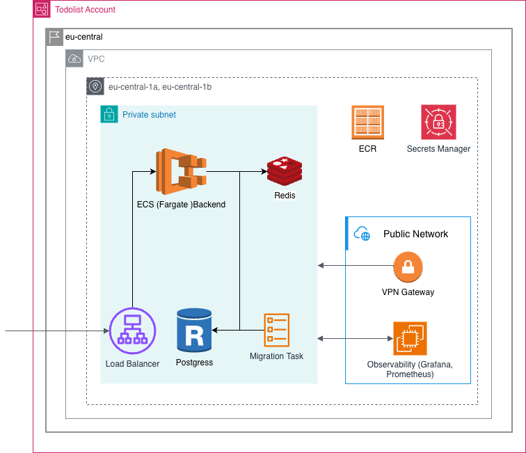

  

_AI made writing the code easy. Running it in production is still hard._

**Prod Forge** is an open-source reference that shows how to build and operate a production-ready system: AI-assisted
development, quality gates, CI/CD, infrastructure, observability, migrations, and rollback.

The implementation is a simple Todo app on purpose, but the architecture follows patterns used in real production
systems at scale, and every major technical decision is documented and explained.

## Start here

Read the guides in this order:

| Step | Guide                                                              | Chapters | Time    | Question it answers                                             |
| ---- | ------------------------------------------------------------------ | -------- | ------- | --------------------------------------------------------------- |
| 1    | [Backend guide](https://github.com/prod-forge/backend#readme)      | 16       | ~3 h    | How do I build and operate a production-ready API?              |
| 2    | [Frontend guide](https://github.com/prod-forge/frontend#readme)    | 17       | ~2 h    | How do I build, ship, and keep web and mobile clients healthy?  |
| 3    | [Infrastructure guide](https://github.com/prod-forge/terraform#readme) | 15   | ~1.5 h  | How do I run all of it on AWS with code, not clicks?            |

## Architecture and stack

  

| Layer          | Tools                                            |
| -------------- | ------------------------------------------------ |
| Web Client     | React · Vite · Redux Toolkit · Tailwind CSS · NX |
| Mobile Client  | Expo · React Native · Redux Toolkit              |
| Deploy         | AWS S3 · CloudFront · ECR · ECS                  |
| Backend        | NestJS · Prisma · PostgreSQL · Redis · Docker    |
| Infrastructure | Terraform · AWS · RDS · ElastiCache              |
| Observability  | Prometheus · Grafana · Loki · Promtail · Tempo   |
| Quality        | ESLint · Prettier · Husky · Commitlint · CI/CD   |

## What this is and what it is not

- A reference with explained decisions: each chapter says what was chosen, why, and what the alternatives were.
- A Todo app on purpose: the domain stays trivial so the production practices stay visible.
- Not a boilerplate or a starter kit to fork and ship as is.
- Not a framework: take the patterns that fit your system and leave the rest.

## Intentionally out of scope

- Identity provider and password management: the API verifies signed JWTs and ships a login-by-email stub, see [Authentication and Authorization](https://github.com/prod-forge/backend/blob/main/docs/security.md#authentication-and-authorization)
- Cursor pagination: list endpoints use offset pagination, see [Performance](https://github.com/prod-forge/backend/blob/main/docs/performance.md#offset-vs-cursor-pagination)
- Live demo or public deployment
- Feature flags
- A/B testing

**Open roadmap:** Kubernetes, blue/green deployment and other open items are tracked in the roadmaps of
[backend](https://github.com/prod-forge/backend/blob/main/roadmap.md),
[frontend](https://github.com/prod-forge/frontend/blob/main/roadmap.md) and
[terraform](https://github.com/prod-forge/terraform/blob/main/roadmap.md).

## Status

| Repository                                          | Last release | CI                                                                                                                  | Docs chapters |
| --------------------------------------------------- | ------------ | ------------------------------------------------------------------------------------------------------------------- | ------------- |
| [backend](https://github.com/prod-forge/backend)    | `v0.2.0`     | Runs on pull requests and pushes to `main`                                                                          | 16            |
| [frontend](https://github.com/prod-forge/frontend)  | `v1.2.2`     | Disabled on purpose, see the [roadmap](https://github.com/prod-forge/frontend/blob/main/roadmap.md)                 | 17            |
| [terraform](https://github.com/prod-forge/terraform) | no release yet | Runs on pull requests and pushes to `main` (offline checks: fmt, validate, tflint, checkov)                      | 15            |

## Contributing

Contributions of any kind are welcome. Read the guidelines of the repository you want to change:
[backend](https://github.com/prod-forge/backend/blob/main/CONTRIBUTING.md),
[frontend](https://github.com/prod-forge/frontend/blob/main/CONTRIBUTING.md),
[terraform](https://github.com/prod-forge/terraform/blob/main/CONTRIBUTING.md).

Questions and ideas: [Discussions](https://github.com/prod-forge/backend/discussions).

## License

[MIT](https://github.com/prod-forge/.github/blob/main/LICENSE)
